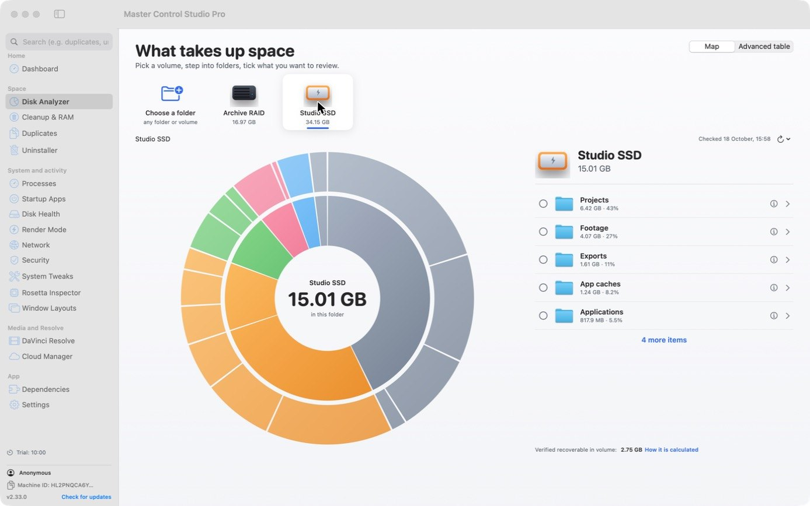
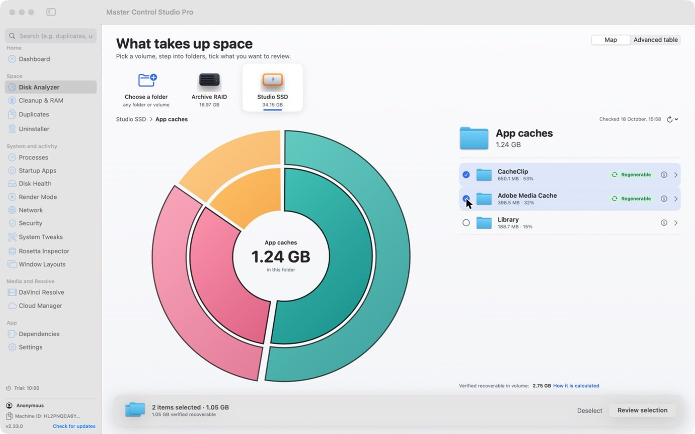
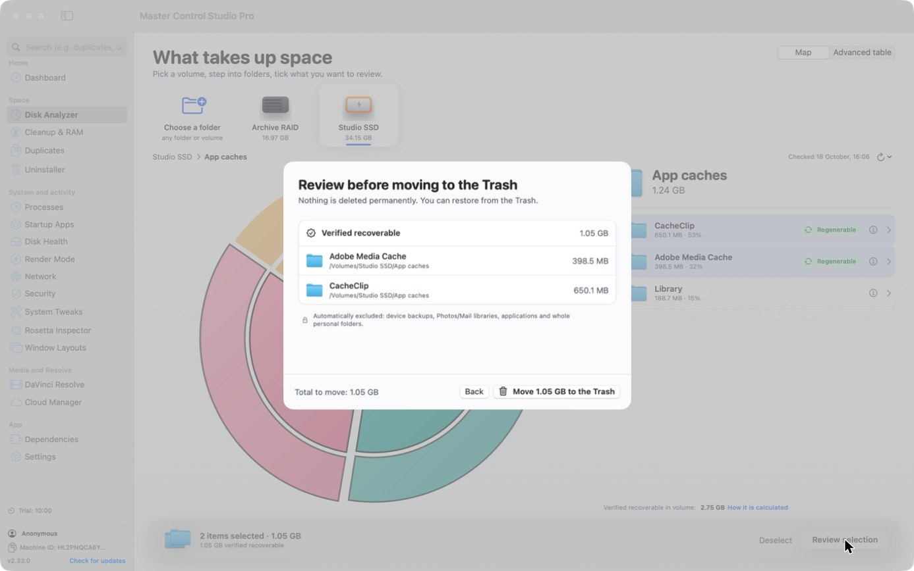
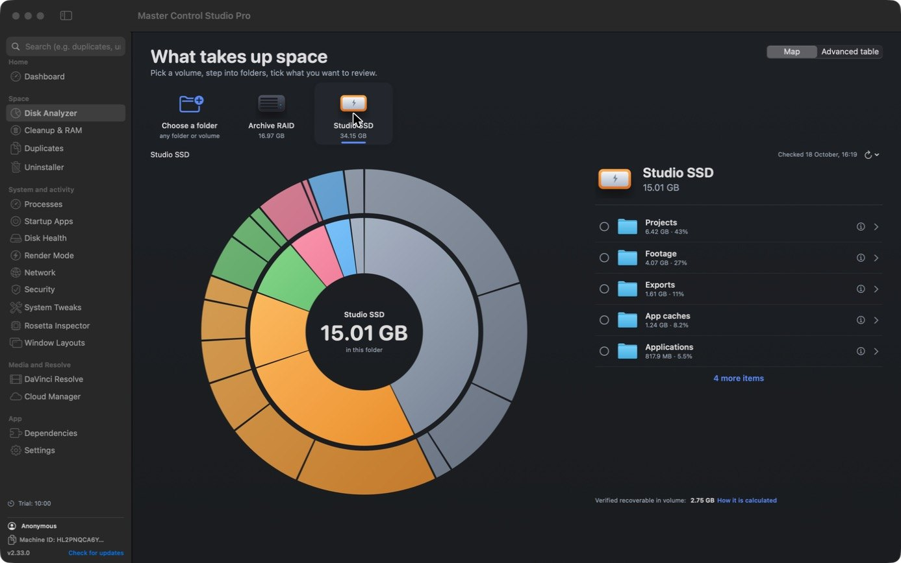
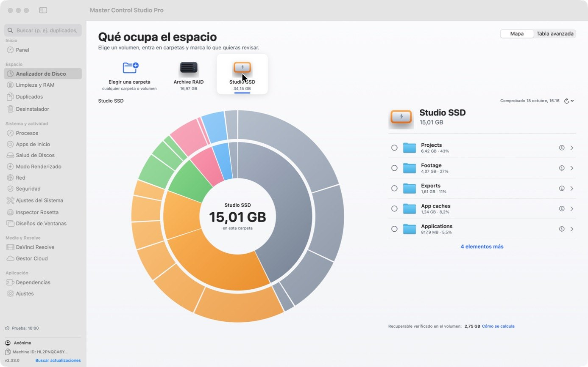

# Master Control Studio Pro — macOS

See what takes up space on your disks, review it, and move it to the Trash **recoverably** — plus the rest of an editing workstation's toolkit: reversible Render Mode, cleanup, duplicates, cloud accounts, security checks. Native SwiftUI, English / Română / Español.

**Download:** [gordas.dev/mac-master-control-pro](https://gordas.dev/mac-master-control-pro/) · [Releases](https://github.com/gordasgdc/mac-master-control-pro/releases/latest) · Windows edition: [mac-master-control-pro-win](https://github.com/gordasgdc/mac-master-control-pro-win)



<table><tr>
<td></td>
<td></td>
</tr><tr>
<td></td>
<td></td>
</tr></table>

*Screenshots are from the real app on demonstration volumes with synthetic data.*

## What it does

- **Disk Analyzer** — proportional radial chart, short list with details on demand, shared selection, review sheet, move to the Trash (never a permanent delete). The recoverable total is computed from verified rules with no double counting; items without a verified rule are never counted and need explicit confirmation. Detects growth and in-place rewrites at any depth, cancels instantly, never reuses a stale cache for a disconnected or replaced volume.
- **Render Mode** — pauses Spotlight indexing and Time Machine while you render; the exact previous state is saved and restored, even after a forced quit.
- **Cleanup & RAM**, **Duplicates** (SHA-256 content comparison), **Cloud Manager** (rclone engine), **Security checks**, **Network tuning**, **Rosetta Inspector**, **DaVinci Resolve** helpers, **Window layouts**.
- **Diagnostics** — local, redacted log and an export without passwords, keys or file contents; nothing is sent automatically. SMTP password in the Keychain.

## Access, licence and limits

- The app runs in **Demo** without an account: 10 minutes of active use, then the next session 48 hours after it ends. Ending the trial never deletes your settings, accounts or data.
- The official edition takes a signed licence in return for a donation (offers are a signed list read inside the app: 5 € / 1 month, 10 € / 3 months, 15 € / 1 year). **One licence = one computer** (Mac *or* Windows); moving it means deactivating the old activation (or an administrator reset) and activating the new one.
- The community edition built from this repository has no activation and stays in Demo.
- Known limits: hard links are counted per link; APFS clones are not told apart by allocated space; cloud-only files are not downloaded to be measured.

## Build

```bash
swift build -c release            # use --scratch-path to keep build output off the system disk
swift test                        # 45 tests
./build_installer.sh              # signed + notarized DMG/PKG (needs Developer ID + notarytool profile)
```

Requires macOS 14+ and Swift 6.

## Licence

Source code under the MIT licence (see `LICENSE`). Dependencies, name, logo and identity assets are not covered by MIT: see `THIRD_PARTY_NOTICES.md`. The official edition activates through GDC rights (donation) without restricting MIT rights over the source.
